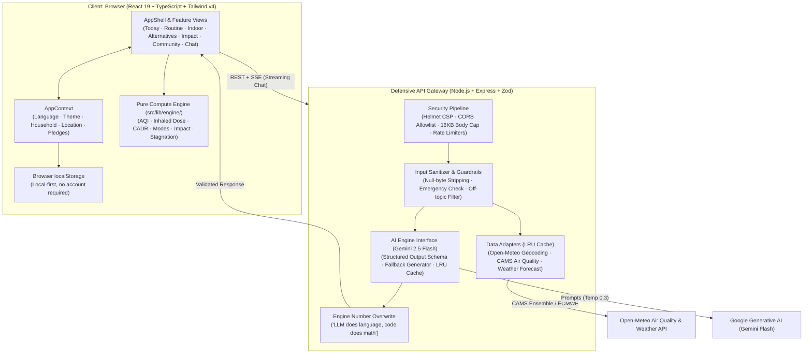

# Breathewise System Architecture

## Core Architectural Invariants

1. **Deterministic Verification Over Generative Hallucination**:
   - The AI language model is strictly restricted to linguistic tailoring and persona empathy.
   - All critical numbers (AQI, WHO factor, exposure dose, CADR, room decay time, CO2e reduction) are computed deterministically in pure TypeScript and overwrite any numbers in the LLM payload before reaching the client.

2. **Local-First Privacy Guarantee**:
   - User profile configurations, child sensitivities, room dimensions, and community pledges remain exclusively in the client's `localStorage`.
   - No authentication, user tracking, analytics cookies, or cloud database storage.
   - 1-click JSON export and 1-click full local data wipe.

3. **Defensive API Gateway**:
   - 16KB request body limit.
   - Strict Zod schema parsing with `.strict()` preventing parameter injection.
   - Null-byte and ASCII control character sanitization.
   - Emergency medical red-flags routed to emergency health resources immediately.
   - CWE-209 error masking suppressing internal server details and traces.
